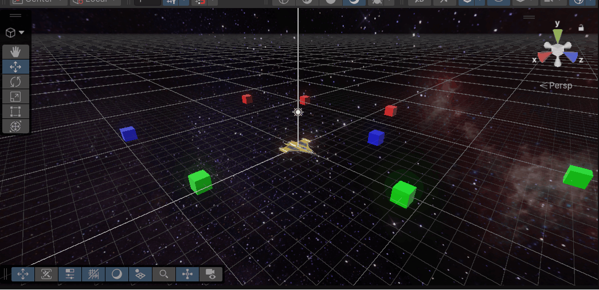
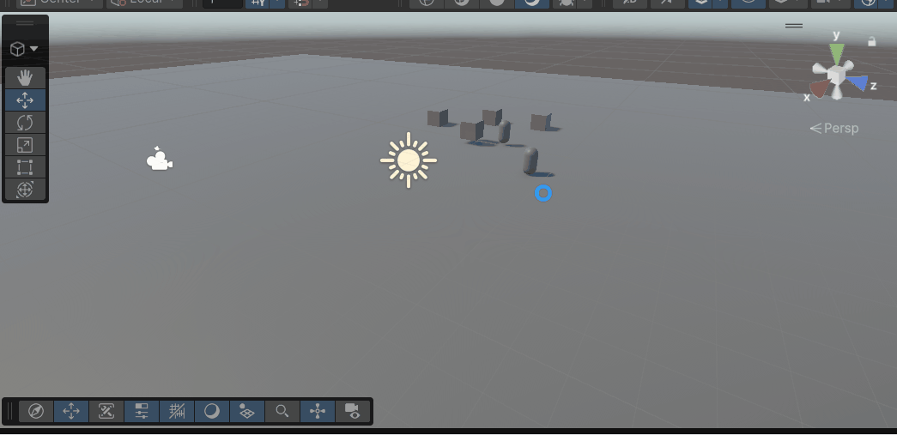

# M5-PROG-opdrachten

## Les 1
Dit gedeelte wordt voor Les 1 van M5.

Opdracht 1.1, je gegevens printen, vondt het een makkelijke opdracht en de screenshot moet te vinden zijn.

Opdracht 1.2, Hp output, het werkt voor de helft wel en ik snap het ook.

Opdracht 1.3, Naam uitprinten, makkelijk, nieuwe functie geschreven en opgeroepen in de start functie.

Opdracht 1.4, grootste nummer berekenen, met een beetje hulp van AI is het gelukt.

Opdracht 1.5, 

screenshots willen niet goed laden, maar het staat in [Les1](M5-Opdrachten).

## Les 2
Dit gedeelte wordt voor Les 2 van M5.

Ik heb deze nog niet gemaakt, maar ik zal dat zeker doen (1-10-2026 22:26)

zit eraan te werken, heb moeite met de pickup een trigger functie te geven. (29-10-2026)

## Les 3
Dit gedeelte wordt voor Les 3 van M5,

Ik was ziek bij deze Les maar ik zal het weer terug lezen om te kijken wat ik moet doen (1-10-2026 22:27)

Ik denk dat ik wat meer context nodig heb voor deze opdrachten, Excuses ervoor dat ik het niet gemaakt heb meneer. (1-10-2026 23:51)

## Les 4
Gegroet, daar been ik weer, Dit is Les 4! 

Voor een of andere redenen doen mijn Gifjes het niet, maar dit is opdracht 4A. Ik ga de codes linken in de Space48 repository die ik moest Forken!

Hierbij de link: https://github.com/CadyDB/Space48.git

opdracht 4B komt hieronder! 

4B kom ik niet volledig uit maar ik link wel de scripts voor 4A in de aSpace48 repo (1-10-2026 23:39)

## Les 5

Hierbij Les 5! bij deze opdracht moest ik het script [EnemyParent](Assets/Les5Scripts/EnemyParent.cs) laten erven met [Brute](Assets/Les5Scripts/Brute.cs) en [Elf](Assets/Les5Scripts/Elf.cs). Ik vond de opdracht een beetje ingewikkeld, maar met hulp dankzij de docent was het gelukt! 

## Les 6
Hierbij Les 6, Screenshots en een link van de tower defense, onderaan de readme in de tower defense is deze opdracht en ik zal uitleggen in deze readme hoeveel public variables ik heb gevonden.

Link naar de repository van de tower defense: https://github.com/CadyDB/TowerDefenseShenanigens.git
In totaal 14 public variables, denk ik tenminste. Alleen de ints maken problemen, de rest doet het allemaal nog prima.

#### Dependancies:

class Enemy 
int health read and write
int currentWayPoints read and write

class Tower
int towerPrice read and write

class CoinManager
int coins read and write

En dat was het voor deze opdracht. Ik vond het best makkelijk nadat ik een goede uitleg heb gehad en alles is gelukt!